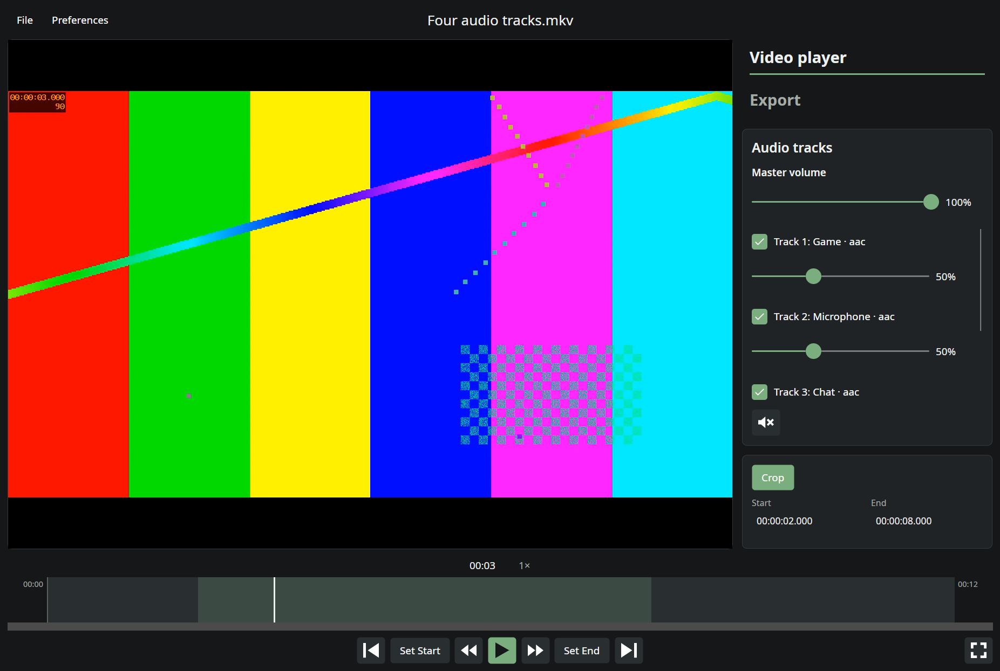
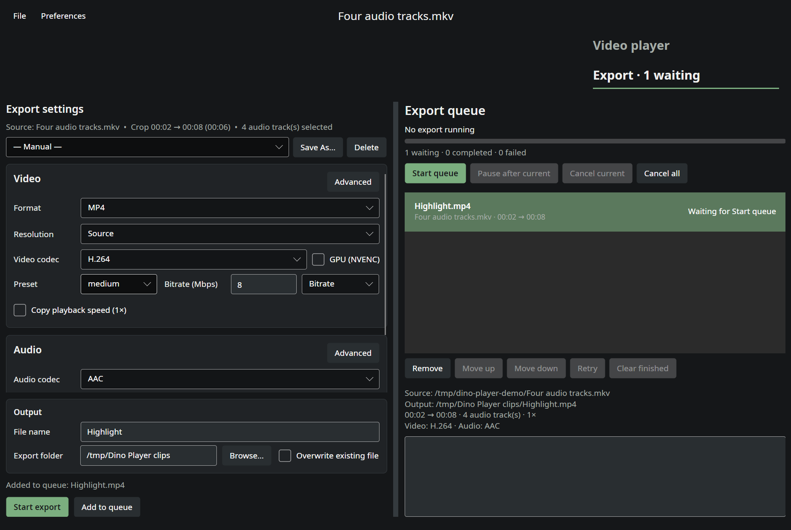

<p align="center">
  
</p>

# Dino Player

A Windows and Linux video player for reviewing gameplay, choosing audio tracks, and exporting clips.

[](https://github.com/DinoRex4848/Dino-Player/actions/workflows/ci.yml)
[Download v1.5.3](https://github.com/DinoRex4848/Dino-Player/releases/tag/v1.5.3) · [User guide](docs/USER_GUIDE.md) · [Development](docs/DEVELOPMENT.md) · [Changelog](CHANGELOG.md)



## What you can do

- Review footage with responsive keyboard skipping, precise timeline seeking, playback speed controls, and fullscreen playback.
- Select individual audio tracks and adjust their volumes before exporting a mix or keeping the tracks separate.
- Mark clip boundaries on the timeline or enable editable timecodes in Preferences.
- Export MP4 or MKV clips with H.264, H.265, or AV1, using CPU encoding or NVIDIA NVENC where supported.
- Choose bitrate, target quality, or a target size that keeps the clip under an upload limit; save export presets, and queue multiple clips while continuing to review videos.
- Run portable builds with preferences beside the application and no separate .NET, mpv, or FFmpeg installation.

## Download and run

Get the ZIP for your platform from the [latest release](https://github.com/DinoRex4848/Dino-Player/releases/latest). Extract the **whole archive** to a writable folder.

| Platform | Start the app | Requirements |
| --- | --- | --- |
| Windows x64 | Open `Dino Player.exe` | Windows 10 or 11, 64-bit |
| Linux x64 | Run `./"Dino Player"` | glibc 2.35+, X11/XWayland, system graphics/audio/font libraries and GPU drivers |

Keep the included `settings.json` beside the application to retain portable preferences. On Linux, run `bash install-desktop.sh` for an optional applications-menu entry. If needed, restore executable permissions with `chmod +x "Dino Player" ffmpeg install-desktop.sh`.

Each release includes a `.sha256` file for verifying downloads. On Linux, run `sha256sum -c Dino-Player-v1.5.3.sha256` beside both downloaded ZIPs. On Windows, use `Get-FileHash -Algorithm SHA256` and compare the result with the checksum file.

The repository is currently private, so repository and release access require permission. Windows builds receive automated build and non-graphical regression checks; interactive Windows playback has not yet been validated. Linux uses X11 through XWayland on Wayland desktops.

## Make your first clip

1. Click the import prompt, use **File → Open**, or drop a video onto the window.
2. Use **Space** to play/pause and **Left/Right** to skip. Choose the audio tracks and volumes you want.
3. Enable Crop and set its start/end using the timeline handles or **Set Start / Set End**.
4. Open **Export**, choose the output folder and encoding settings, then use **Start export** or **Add to queue**.



See the [user guide](docs/USER_GUIDE.md) for presets, queue controls, keyboard shortcuts, and portable settings.

## Build from source

Install the .NET 10 SDK, libmpv, and FFmpeg, then run from the repository root:

```bash
dotnet restore DinoPlayer.MP.slnx
dotnet build DinoPlayer.MP.slnx -c Release --no-restore
dotnet run --project src/DinoPlayer.MP -c Release --no-build
```

Windows needs an x64 `libmpv-2.dll` beside the executable or `DINOPLAYER_MPV_LIBRARY` pointing to it. FFmpeg must be on `PATH`, or specified by `DINOPLAYER_FFMPEG`. Native binaries and publish outputs are kept out of Git.

Read [Development](docs/DEVELOPMENT.md) for platform setup, test commands, portable publishing, and release steps. The app uses C#/.NET 10, Avalonia, libmpv, and FFmpeg.

## Feedback and license

Use [Issues](https://github.com/DinoRex4848/Dino-Player/issues) to report bugs or suggest features. Include your app version, platform, and steps to reproduce a problem.

Dino Player is licensed under [GNU GPL v3.0](LICENSE). Third-party components retain their own licenses; notices are in [packaging/licenses](packaging/licenses) and included with portable releases.

## AI assistance

Dino Player was made with substantial assistance from ChatGPT and OpenAI Codex, including help writing and debugging code, developing tests, and preparing documentation and releases. I'm still learning to code, and I want to be transparent that this project reflects that collaboration.
