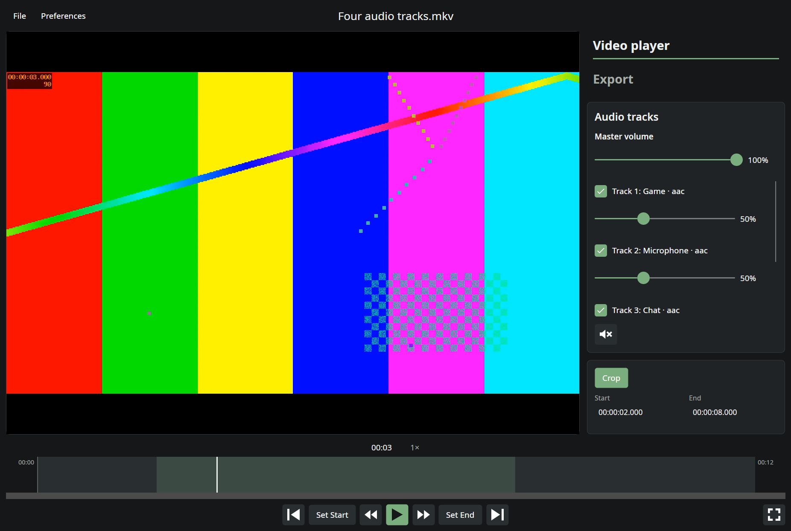

# Using Dino Player

## Portable installation

Download the Windows x64 or Linux x64 ZIP from [Releases](https://github.com/DinoRex4848/Dino-Player/releases/latest). Extract the whole archive to a writable folder before starting the application. No separate .NET, mpv, or FFmpeg installation is required.

Keep `settings.json` beside the executable: preferences and presets are stored there. Runtime logs and the playback script cache use a `data/` folder; the newest 20 logs are kept. Native libraries bundled by .NET are extracted to its user cache.

Windows requires x64 Windows 10/11. Linux requires x64, glibc 2.35 or newer, X11/XWayland, working graphics/audio/font libraries, and suitable GPU drivers. If ZIP extraction removes executable permissions, run `chmod +x "Dino Player" ffmpeg install-desktop.sh`. Run `bash install-desktop.sh` after moving the Linux folder to its permanent location to add an optional applications-menu launcher. The launcher also offers Dino Player under **Open With** for MP4, MKV, WebM, MOV, AVI and TS videos.

## Exporting clips and using the queue

The main window has **Video player** and **Export** tabs. Select a crop, audio tracks, track volumes, and playback speed in the player, then open Export. The tab retains your encoding settings between clips. Playback pauses while viewing Export and resumes on return if it was previously playing.

**Start export** exports the current clip immediately. **Add to queue** saves a clip for **Start queue**, which runs clips one at a time. Adding clips while a queue runs appends them to that run. During an independent export, Add to queue leaves saved clips waiting; Start export schedules another immediate clip after the current work. Saved or paused queue jobs remain waiting until you start or resume the queue.

Switch to **Video player** to watch, seek, select more clips, or open another video while exporting. Each submitted clip keeps its original source and settings. Queue controls support removing and reordering waiting clips, pausing after the current clip, cancelling the current clip or all unfinished work, and retrying failures. A failed clip does not stop the remaining queue; select its row to inspect the FFmpeg log. **Show in folder** opens the folder of the selected finished clip, or of the latest finished clip when none is selected, with the file highlighted where the file manager supports it.

**Export clip**, at the bottom left below the timeline, exports the current crop straight away (also **Ctrl+E**, or **File → Export clip now**). It uses the settings currently selected in Export, without switching tabs or pausing playback, and shows a confirmation beside the button. With Crop off, the full video is exported. Progress shows in the Export tab's header.

Enable **Show Add to queue button in player** in Preferences to queue clips directly from the bottom left below the timeline. Each click captures the current crop, audio choices, and the settings currently selected in Export without switching tabs or pausing playback. A confirmation appears beside the button and fades out after eight seconds; another click restarts that display period. With Crop off, the full video is queued. The configured default export preset is applied on the first Export visit or first use of this button; later clicks keep your edits. The option is off by default.

Resolution sets the output height: **720p**, **1080p**, **1440p** or **2160p (4K)**. The width follows the source's shape, so ultrawide and 4:3 recordings keep their proportions with square pixels. The dropdown beside the video bitrate field switches between **Bitrate**, **Target quality** and **Target size**, remembering each value separately. Target quality uses **CRF** for CPU encoding and **CQ** for GPU (NVENC) encoding. Lower values increase quality and output size varies with the content. Quality accepts whole numbers: CPU H.264/H.265 0–51, CPU AV1 0–63, NVENC H.264/H.265 1–51, and NVENC AV1 1–63. NVENC zero means automatic rather than a chosen target. Quality starts at 23. Copy disables rate controls, and Advanced uses your custom arguments. Resolution, rate mode, quality and size are saved with export presets. With **GPU (NVENC)** on, the source is also decoded on the GPU, which uses about a third of the CPU time. Sources the GPU can't decode, such as 4:4:4 H.264, are decoded on the CPU automatically.

**Target size** keeps the exported file under a size in MB, such as a chat app's upload limit. It starts at 10 MB; 1 MB is 1,000,000 bytes, so the file also fits limits counted in MiB. Dino Player works out the video bitrate from the clip length (after any crop and copied speed) and the audio bitrate, and shows it under the field. A short clip gets a high bitrate, and a long one a low bitrate. When it drops below 2 Mbps, the hint suggests 720p, which looks sharper than a blocky 1080p at small sizes. Target size needs AAC or Opus audio (or no audio tracks), because FLAC and copied audio have no fixed bitrate.

Finished files usually come out at 70–95% of the size. H.264, H.265 and every NVENC codec cap their bitrate, so they rarely go over. CPU AV1 has no cap and can go up to about 15% over on short clips. If a file is over the limit, it is encoded again at a lower bitrate, up to three attempts in total, and the clip's log shows each size. If it still doesn't fit, or a lower bitrate stops making it smaller (very detailed footage at a high resolution), the export fails without saving a file. In that case, choose a lower resolution, a shorter clip or a larger size.

The FFmpeg log has a fixed height and internal scrollbars. It follows new output while you are at the bottom and preserves your position when you scroll back to inspect earlier lines.

The queue list scrolls independently, keeping progress and queue controls in place as more clips are added. Small windows can also scroll the surrounding queue controls when needed. Default Export settings fit in a maximized 1920×1080 window at 100% scaling; paired fields return to separate rows when the settings pane is narrow.

Output has separate **File name** and **Export folder** fields. Browse chooses a folder only. Until you choose one, the folder follows each video: the Preferences default location, or the video's own folder. A folder chosen with Browse is kept for later videos. Select **MP4** or **MKV** under Video settings; the extension is added automatically and the format is saved with export presets. A pasted MP4/MKV suffix is removed from the base filename before the chosen extension is added.

Clips receive distinct output filenames automatically. **Overwrite existing file** allows replacing an existing file on disk, while queued clips still receive separate destinations. Exports write to a temporary file and publish it only after success; failure or cancellation removes incomplete output and preserves any original destination file.

The queue is stored only for the current session. Closing with unfinished jobs offers **Keep open** or **Cancel exports and close**; jobs are not restored after restarting.

## Player UI and appearance

The player below shows gameplay paused at **00:25**, with a **00:20–00:30** crop selected. The highlighted timeline region marks the portion to export when Crop is enabled.

With no video open, click the import prompt, drop a video on it, or use **File → Open**. Opening a video with Dino Player from a file manager, or passing its path on the command line, loads it at startup. The right sidebar contains workspace tabs, a scrolling audio panel, and a separate crop panel. The fullscreen control is below the timeline; F11 and double-clicking the video also toggle fullscreen.

New imports stay paused at the beginning while saved audio-track settings are restored and the mix is applied. Playback waits for mpv to finish preparing the starting frame, then begins from 00:00, or remains paused if the player was already paused. Controls become available after setup. Recreating the native video surface restores the previous position and pause state. Both timelines refresh directly from mpv's seek, restart, pause and speed changes, so jumps and the play/pause button update at once. While playing, the playhead moves smoothly on every display frame.

Player controls do not take keyboard focus, including audio sliders, track checkboxes, workspace tabs, and fullscreen controls. Space toggles playback. Left/Right and the skip buttons make fast jumps of about five seconds, and rapid presses or holding an arrow accumulate through mpv. Jumps land on keyframes, so the actual distance depends on the video. Timeline clicks, fullscreen timeline adjustments, and crop-boundary jumps use precise positioning. Dragging along either timeline or a crop handle previews with fast keyframe jumps and lands exactly where you let go, so you can see the frame at a crop boundary while adjusting it. The configured speed shortcuts remain available after clicking controls. Crop times display as plain text by default; use **Set Start**, **Set End**, **I** / **O**, or drag the timeline crop handles. Set Start, Set End, I and O use the exact frame on screen, even during playback. Turn on **Enable editable crop times** in Preferences to replace them with timecode fields accepting **HH:MM:SS** or **HH:MM:SS.mmm**. Enter or leaving the field applies the edit; Escape cancels it. Playback shortcuts leave typing alone while a crop field has focus. Saving the preference applies it immediately. Export text fields, dropdowns, and checkboxes retain keyboard focus, while its action buttons do not.

| Key | Action |
| --- | --- |
| Space | Play or pause |
| Left / Right | Jump about five seconds to a keyframe |
| Shift+Left / Shift+Right | Move exactly one second |
| , / . | Previous / next frame (pauses) |
| I / O | Set crop start / end at the current frame, turning Crop on. With no earlier selection, the first mark selects ten seconds. |
| Up / Down | Master volume up / down by 5% |
| M | Mute or restore master volume |
| Ctrl+E | Export the current crop now (Export clip) |
| = / - | Speed up / slow down (configurable in Preferences) |
| F11, Escape | Toggle fullscreen, leave fullscreen |

Speed shortcuts cannot use the keys above. A speed shortcut saved by an earlier version on one of the newer keys (, . I O M Up Down) keeps working and takes priority over that key.

The mute toggle sets master volume to zero and restores the previous positive volume on the next click. Both master sliders stay synchronized, and the restoration volume survives media changes during the current session. Track selections and individual volumes remain intact, so muting playback does not change exported audio. The audio scrollbar widens immediately on hover in its own lane beside the track percentages.

**Preferences** contains **Playback at end: Stop / Loop**, **Show diagnostic log**, and **Show Add to queue button in player**, with explanatory info tooltips. Saving applies these immediately. Loop repeats the whole video. The optional player log is a collapsed expander below the playback controls; file logging and export-job logs remain active when it is hidden. Import and playback failures appear in an error banner. **File → Exit** uses the normal shutdown flow and warns about unfinished exports.

The graphite-and-green palette lives in `src/DinoPlayer.MP/Styles/Palette.axaml`, shared styles in `Styles/Theme.axaml`, and vector icons in `Styles/Icons.axaml`. Edit these resources to tune the appearance across the player, export controls, preferences, and dialogs.
